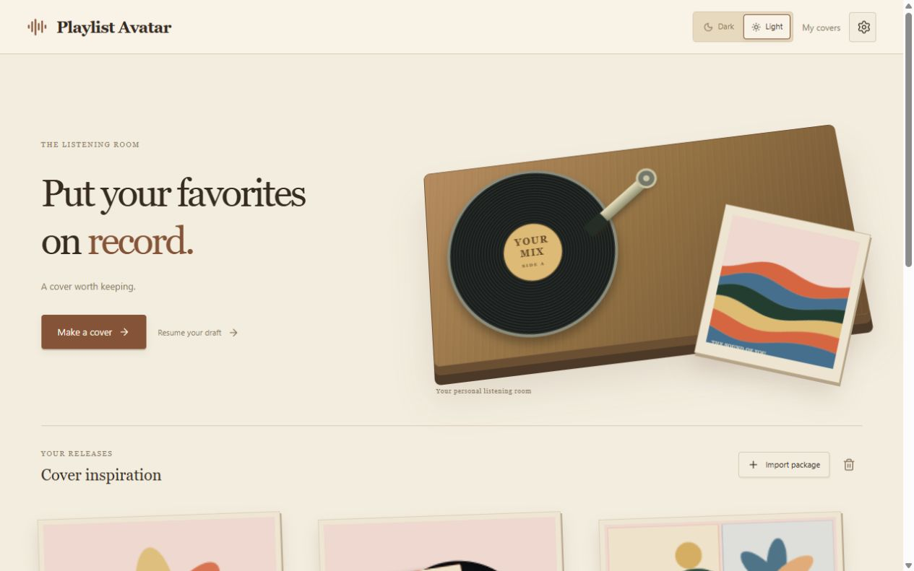
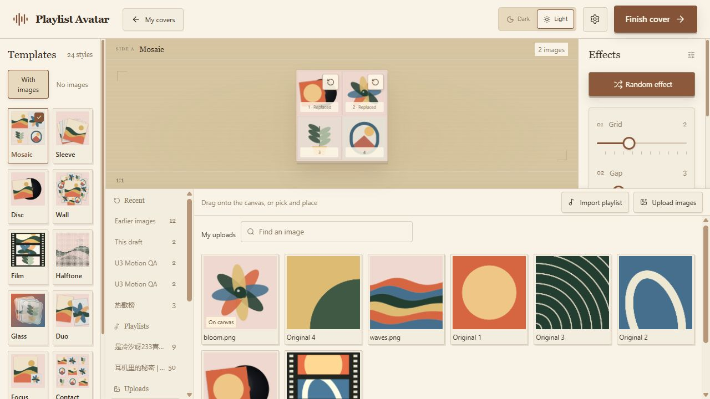

# Playlist Avatar

[完整中文说明](README.zh-CN.md)

A listening room for your covers. Turn public NetEase Cloud Music or QQ Music playlists, your own pictures, or original generative styles into an avatar or cover. Pick a template, place pictures if needed, adjust a few effects and save or export. The ordinary workflow needs no music account, API key or custom server address.





24 distinct styles include cover collages, print textures, generative compositions and optical materials. Export PNG, JPG or WebP at 512, 1024 or 2048 pixels, with optional circular cropping and transparent PNG/WebP backgrounds. Abstract styles use composition parameters and available source counts; they do not analyze audio.


## Start on your computer

You need Docker Desktop running, an internet connection for the initial build and public playlist imports, and a current browser. Docker builds the application; you do not need to install Node, a database or Redis.

1. Extract the source archive into a folder. Keep `compose.yaml`, `Dockerfile`, `apps`, `packages` and the other supplied files together.
2. Open a terminal in that folder. On Windows, open the folder in File Explorer, type `powershell` into its address bar and press Enter. On macOS/Linux, open Terminal and change to the extracted folder.
3. Run:

   ```sh
   docker compose up -d --build
   ```

4. Wait for the build to finish, then open **[http://127.0.0.1:8080](http://127.0.0.1:8080)**. Keep using this exact address for access to the same browser library.

If port 8080 is already in use, copy `.env.example` to `.env` and change **both** lines below before starting:

```dotenv
APP_PORT=18080
PUBLIC_ORIGIN=http://127.0.0.1:18080
```

Then open [http://127.0.0.1:18080](http://127.0.0.1:18080). On Windows you can copy the file with `Copy-Item .env.example .env`; on macOS/Linux, `cp .env.example .env`. Keep `.env` private if you later add an optional key.

## Make your first cover

1. On the home page, choose **New cover** or an inspiration template. Saved covers have a separate collection with an internally scrolling card area. The introductory home page has an inspiration strip that cycles through all24 templates a screen at a time, loading small previews only for the current and neighboring groups; the sleeve beside the record fades through eight original covers about every five seconds.
2. Keep the template picker open on the left. **No images** templates need only their effects; **With images** templates begin with original illustrations in fixed positions.
3. For photo templates, use **Import playlist** or **Upload images** in the lower panel. Read a public share link and choose **Keep these covers**. Before adding any pictures, the whole image panel offers centered Import playlist and Upload images buttons. Images are grouped automatically under Recent, Playlists, Uploads and Covers; choose a source once to see its searchable, paginated grid. Importing leaves the current artwork intact.
4. Drag a picture onto a canvas position, or click one picture and then one position. A placement clears that selection. Use the same picture in several positions if you want; **On canvas** marks pictures currently used. A changed position's restore button returns to its original image when editing, or its illustration when creating a new cover.
5. Use the few effect sliders on the right. **Random effect** changes these visible parameters and records the result; Undo/redo and Ctrl/Cmd+Z can retrieve it. **Reset** restores style defaults while retaining placements. The Type template has its own lettering field. Switching templates retains your work in each template and moves the entire paper card along a gentle curve, with a fade.
6. Choose **Finish cover**. **Export image** is also available in each saved cover's menu. The export dialog updates an encoded preview when you change size, format, background or circular crop; Download saves that exact preview. Give it a name for the collection, or **Export** PNG/JPG/WebP at 512, 1024 or 2048px. Export can crop a circle; PNG/WebP support transparency and JPG uses a solid background. **Save image file** is available if the first download does not start.

Templates, effects and images scroll within their own areas while the canvas and Finish control stay available. Preferences provides English/Chinese, light/dark themes and reduced motion. The home record slowly rotates, while cover hover, cropped photo placement and short transitions are part of the listening-room style; there is no audio playback or audio analysis.

## Save and manage covers

**Save to my collection** stores the recipe and real image Blobs in this browser. Opening and saving a cover updates it. The header ticket switches between My works and Back home. The collection lists covers directly without a secondary heading or search, places matching New cover and Resume your draft buttons together and keeps its header/footer fixed while its cards scroll. A cover's menu offers editing, creating from a template, renaming, Export image and deletion. Movement commands appear when there is more than one cover; unavailable directions are disabled. You can also drag cards to reorder them.

Export image reads the selected saved work without replacing your current draft. Its preview is the actual encoded PNG/JPG/WebP at the selected size; transparent/circular/background/quality settings update it automatically. Download uses that same image. Project-package ZIP import and backup have been removed; playlist import and image upload remain.

Automatic drafts and Recent images remain. Each work preserves its template variants, image placements and restoration baselines, with at most50 unique pictures in one workspace. Unselected source pictures remain in the image library. Existing saved recipes and template IDs retain their appearance until explicitly edited or reset.

The library belongs to the browser profile and exact website origin, including protocol, host and port. Keep the same origin/profile when updating. Export finished images you need before clearing local data; those images can later be uploaded as materials. There is no editable-work transfer between browsers in this version. See [updates and local data](docs/maintenance.md).

**Preferences → Manage local data** displays counts. Empty scopes cannot be selected, and confirmation is disabled without a valid selection. Deletion and clearing require confirmation and cannot be undone; image-library materials remain when deleting a work. Storage/quota failures do not silently delete works.

## Stop, restart and check

Run these in the same folder:

```sh
docker compose ps
docker compose stop
docker compose start
docker compose logs --tail 30
```

`stop` stops this application; closing the browser page does not stop its container or Docker Desktop. `docker compose down` removes the application container/network; browser artwork remains in the browser. Do not clear browser site data unless you have backed up the works you need.

## Local images and NAS

The release candidate is available as locally built images; **no public registry URL has been published**. You can build from source with the command above, or load a supplied matching image archive:

Version0.2.4 is a local working-tree/runtime update without new release archives. The retained0.2.1 image below has the older interface; select `PLAYLIST_AVATAR_IMAGE=playlist-avatar:0.2.1-local` in `.env` when loading it. Build the current source for the new interface.

```sh
docker load -i playlist-avatar-0.2.1-amd64.tar.gz
docker compose up -d --no-build
```

The 0.2.1 ARM archive is built, but its runtime has not been validated in this update because this host cannot execute ARM emulation. For a native 64-bit ARM host, load `playlist-avatar-0.2.1-arm64.tar.gz`, set `PLAYLIST_AVATAR_IMAGE=playlist-avatar:0.2.1-arm64` in `.env`, and use the same `up -d --no-build` command. The image tags are local names, not downloadable registry addresses. See [release status and tested architectures](docs/release.md).

The default binding accepts connections from this computer only. For a NAS or another device, configure a trusted HTTPS reverse proxy, set `PUBLIC_ORIGIN` to its exact browser-facing origin, and expose the container only to that proxy. Browser storage and image hashing require a secure context: HTTPS, or a local loopback address. Plain `http://NAS-IP` is not the supported remote setup. The proxy must preserve the configured Host and the security headers. Do not mount your music library or Docker socket into this application. See [deployment options](docs/deployment.md).

## Optional music libraries

**More sources** is an opt-in advanced entry. Last.fm requires an administrator's server-side key; then the user supplies only a username and native period. Navidrome/OpenSubsonic, Jellyfin and a compatible private NetEase API require an explicitly configured allowed profile and the user's own access. These services are not started by the default Compose file.

Real-instance compatibility for these optional sources has **not been verified** in this release candidate. Their adapters and isolation have fixed-response tests; this is not a compatibility guarantee. QQ private sessions are unavailable rather than presented as a working login flow. [Advanced configuration and target versions](docs/advanced-sources.md).

## Privacy, limits and troubleshooting

The browser edits, stores and exports artwork. The Node service receives the needed public link/ID, reads the chosen music source and forwards bounded cover images. Optional private credentials go to your deployed Node service and the selected allowed music service. The app has no default telemetry or automatic account/LAN discovery. Public metadata has a bounded five-minute in-memory cache; image tickets expire and are not a permanent image store. Platform artwork is not bundled with the application; use images you are entitled to use.

The default container has a 256MiB memory limit and one-CPU quota. Imports have at most 2 active parses, 8 waiting and 4 cover streams, 2,000 metadata entries per range and 50 candidate covers. A canvas displays at most16 image positions; a workspace keeps up to50 unique pictures across its template variants and baselines. The library holds up to1,000 images within the storage budget. Local images accept PNG/JPEG/WebP up to20MiB/24MP; remote images are bounded to8MiB/16MP. Normalized import batches have a32MiB budget. Browser work storage is bounded to500MiB and the browser's available quota. These protection limits are not measured idle usage. [Measured results and validation gaps](docs/release.md).

| Symptom | What to try |
| --- | --- |
| Port is occupied | Choose a free port and update both APP_PORT and PUBLIC_ORIGIN. |
| Page/API reports forbidden | Use the exact configured origin; check the reverse proxy Host. |
| Public playlist cannot be read | Verify it is public; retry later, use another link or local images. Login is not required as a fallback. |
| A cover is missing / skipped | Select another ready candidate or a local image; preserve the existing work. |
| Saving failed | Export needed finished images, check storage permissions/free space and review the scopes in Manage local data. |
| Browser cannot encode JPG/WebP | Choose PNG. The app checks real encoding instead of changing a file suffix. |
| Remembered advanced connection expired | Reconnect to the configured profile; server restarts invalidate temporary sessions. |

For development, see [development.md](docs/development.md). Third-party license texts are included in the source and image. Project-owned code remains `UNLICENSED` while the owner selects the public release license and publishing destination.
