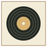
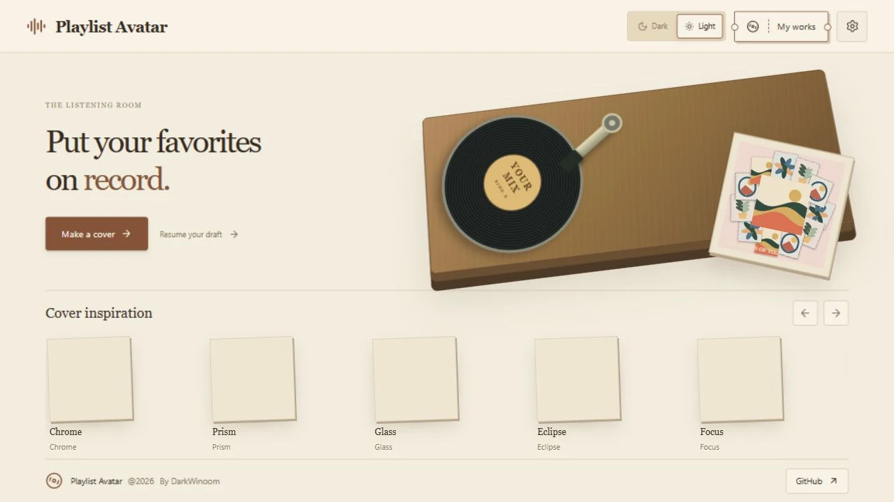
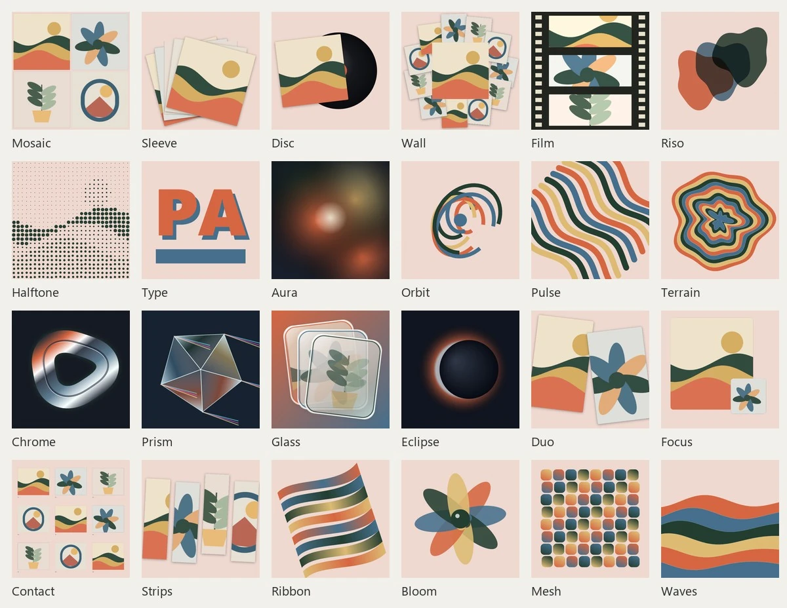
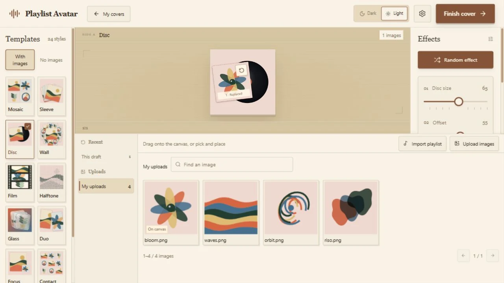
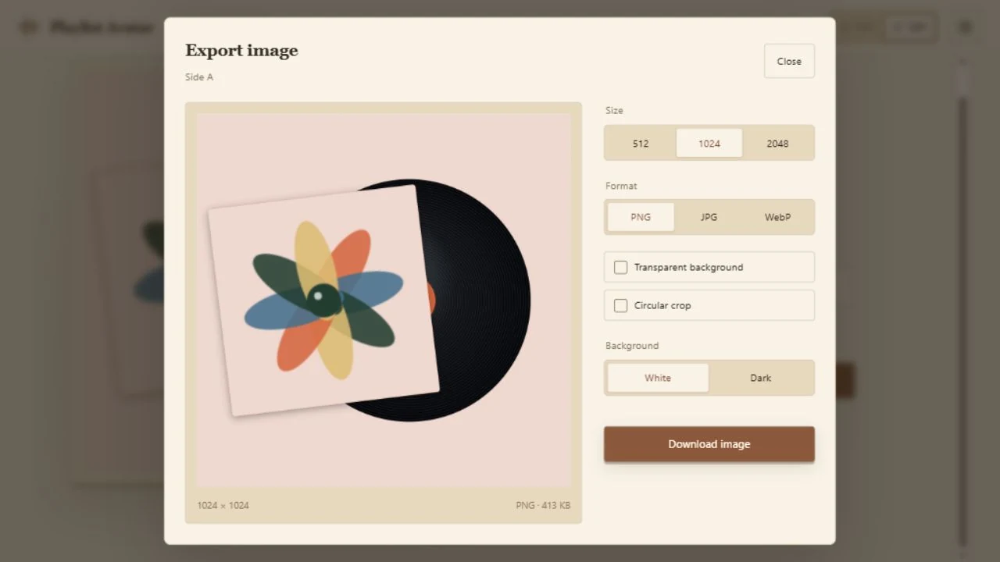

<div align="center">



# Playlist Avatar

**Your music. Your cover.**

**English** · [简体中文](README.zh-CN.md)


Bring a NetEase or QQ Music playlist, your own pictures, or start with original artwork.
Choose a style, make it yours, and take it with you.

</div>



## Find your rhythm

24 styles: records, collages, print textures, glowing shapes and flowing lines. No pictures needed to get started.



| Make it personal | A little motion |
| --- | --- |
| Import a public playlist or upload pictures. Drop one onto the canvas to replace a cover. | Spinning records, paper transitions and direct placement. A listening room in light or dark. |
| **Less second-guessing** | **Your own collection** |
| A few sliders, random effects, Undo and Reset help you find something you love. | Keep your covers, revisit them, rename or reorder. Your draft is there when you return. |



## Take it with you

Export from the cover menu. Preview the result, then download that exact image.
PNG / JPG / WebP · 512 / 1024 / 2048px · Circular crop · Transparent backgrounds



## Run with Docker

Download and unzip the [source](https://github.com/DarkWinoom/playlist-avatar/archive/refs/heads/main.zip), then run this in its folder:

```sh
docker compose up -d --build
```

Open **[http://127.0.0.1:8080](http://127.0.0.1:8080)** and make your first cover.

No music account or API key needed. Covers and drafts stay in this browser; use the same address to return to them.
Public playlists need an internet connection. Your own pictures and original styles work just as well.

---

<div align="center">

[Report an issue](https://github.com/DarkWinoom/playlist-avatar/issues) · [Third-party notices](THIRD_PARTY_NOTICES.md)

Playlist Avatar © 2026 DarkWinoom

</div>
