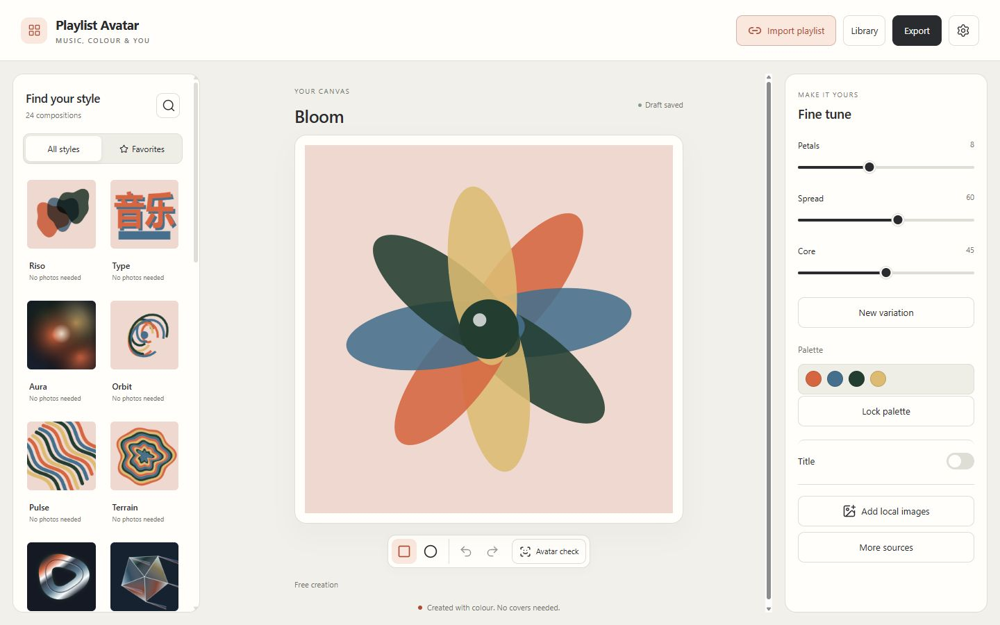

# Playlist Avatar

[完整中文说明](README.zh-CN.md)

Turn a public NetEase Cloud Music or QQ Music playlist into an avatar or cover. Open Import playlist, paste its share link, pick a style, adjust the artwork and download it. Start instantly with a composition made from colour, or use original sample covers and your own images. The ordinary workflow needs no music account, API key or custom server address.



24 distinct styles include cover collages, print textures, generative compositions and optical materials. Export PNG, JPG or WebP at 512, 1024 or 2048 pixels, with optional circular cropping and transparent PNG/WebP backgrounds. Abstract styles use composition parameters and available source counts; they do not analyze audio.


## Start on your computer

You need Docker Desktop running, an internet connection for the initial build and public playlist imports, and a current browser. Docker builds the application; you do not need to install Node, a database or Redis.

1. Extract the source archive into a folder. Keep `compose.yaml`, `Dockerfile`, `apps`, `packages` and the other supplied files together.
2. Open a terminal in that folder. On Windows, open the folder in File Explorer, type `powershell` into its address bar and press Enter. On macOS/Linux, open Terminal and change to the extracted folder.
3. Run:

   ```sh
   docker compose up -d --build
   ```

4. Wait for the build to finish, then open **[http://127.0.0.1:8080](http://127.0.0.1:8080)**. Keep using this exact address for access to the same browser library.

If port 8080 is already in use, copy `.env.example` to `.env` and change **both** lines below before starting:

```dotenv
APP_PORT=18080
PUBLIC_ORIGIN=http://127.0.0.1:18080
```

Then open [http://127.0.0.1:18080](http://127.0.0.1:18080). On Windows you can copy the file with `Copy-Item .env.example .env`; on macOS/Linux, `cp .env.example .env`. Keep `.env` private if you later add an optional key.

## Make your first image

1. A new workspace starts with a colour composition that needs no images. These styles appear first until you supply photos or a playlist. Existing drafts and artworks reopen with their saved template.
2. To use music covers, copy a **public playlist** share link or share text from NetEase or QQ Music. Click **Import playlist**, paste into the dialog and click **Read playlist**. A bare numeric ID may ask you to choose its platform.
3. Check the returned title and counts. Choose **Use these covers** when the new covers are ready. Unavailable covers and budget skips are reported; a failed or cancelled import preserves your artwork. Large playlists show their actual read range and may offer **Next range**. Each range is a separate import.
4. Choose a template and adjust its controls. Drag thumbnails to reorder them, or onto a cover in the canvas to replace or swap it. Unused materials stay in the library. **Reframe image** supports zoom, drag, direction buttons and arrow keys; **Arrange materials** offers source order, shuffle and available count weighting. Styles that need no images hide photo editing; missing statistics are not invented. Undo/redo supports buttons and Ctrl/Cmd+Z.
5. Choose **Export**, select the size and format, and click **Download**. If your browser does not save automatically, use **Save image file** below the actual export preview. A circular preview is separate from the export's **Circular crop** setting. JPG uses the selected solid background.

On a narrow screen, use the bottom **Playlist / Styles / Materials / Adjust** tools. Preferences provides English/Chinese, light/dark/system themes and reduced motion. Keyboard controls and the system's reduced-motion preference are supported.

## Save your work

**Library → Save current / Save as** stores the recipe and actual image data in this browser. The draft also saves automatically when browser storage is available; read the status next to the preview. Saved artwork can be reopened and exported after the music service is unavailable, while the already loaded editor remains open.

The library is specific to the **browser profile and website origin** (protocol, hostname and port). Another browser, device, port, `localhost` spelling or HTTP/HTTPS address has a separate library. The app is not an installed offline PWA; starting a fresh page still requires the application server.

Use **Library → Backup** to download a ZIP containing the project's recipe, selected and unused normalized materials, and image framing. Use **Import artwork file** to restore a backup as a new project. Backup before clearing site data, moving addresses, changing browsers or updating the application. Connections and credentials are excluded from artwork packages. See [backup, updates and rollback](docs/maintenance.md).

Deletion moves projects to the application's Trash after confirmation, where they can be restored. **Manage data → Works (including deleted)** permanently clears all named projects, including Trash, after a separate confirmation; it is not a Trash-only action. Clear-data controls let you choose scopes. A failed save or storage quota does not automatically delete saved artwork.

## Stop, restart and check

Run these in the same folder:

```sh
docker compose ps
docker compose stop
docker compose start
docker compose logs --tail 30
```

`stop` stops this application; closing the browser page does not stop its container or Docker Desktop. `docker compose down` removes the application container/network; browser artwork remains in the browser. Do not clear browser site data unless you have backed up the works you need.

## Local images and NAS

The release candidate is available as locally built images; **no public registry URL has been published**. You can build from source with the command above, or load a supplied matching image archive:

```sh
docker load -i playlist-avatar-0.1.1-amd64.tar.gz
docker compose up -d --no-build
```

The 0.1.1 ARM archive is built, but its runtime has not been validated in this update because this host cannot execute ARM emulation. For a native 64-bit ARM host, load `playlist-avatar-0.1.1-arm64.tar.gz`, set `PLAYLIST_AVATAR_IMAGE=playlist-avatar:0.1.1-arm64` in `.env`, and use the same `up -d --no-build` command. The image tags are local names, not downloadable registry addresses. See [release status and tested architectures](docs/release.md).

The default binding accepts connections from this computer only. For a NAS or another device, configure a trusted HTTPS reverse proxy, set `PUBLIC_ORIGIN` to its exact browser-facing origin, and expose the container only to that proxy. Browser storage and image hashing require a secure context: HTTPS, or a local loopback address. Plain `http://NAS-IP` is not the supported remote setup. The proxy must preserve the configured Host and the security headers. Do not mount your music library or Docker socket into this application. See [deployment options](docs/deployment.md).

## Optional music libraries

**More sources** is an opt-in advanced entry. Last.fm requires an administrator's server-side key; then the user supplies only a username and native period. Navidrome/OpenSubsonic, Jellyfin and a compatible private NetEase API require an explicitly configured allowed profile and the user's own access. These services are not started by the default Compose file.

Real-instance compatibility for these optional sources has **not been verified** in this release candidate. Their adapters and isolation have fixed-response tests; this is not a compatibility guarantee. QQ private sessions are unavailable rather than presented as a working login flow. [Advanced configuration and target versions](docs/advanced-sources.md).

## Privacy, limits and troubleshooting

The browser edits, stores and exports artwork. The Node service receives the needed public link/ID, reads the chosen music source and forwards bounded cover images. Optional private credentials go to your deployed Node service and the selected allowed music service. The app has no default telemetry or automatic account/LAN discovery. Public metadata has a bounded five-minute in-memory cache; image tickets expire and are not a permanent image store. Platform artwork is not bundled with the application; use images you are entitled to use.

The default container has a 256MiB memory limit and one-CPU quota. Imports have at most 2 active parses, 8 waiting and 4 cover streams, 2,000 metadata entries per range, 50 candidates and 16 selected covers. Local images accept PNG/JPEG/WebP up to20MiB/24MP; remote images are bounded to8MiB/16MP. Normalized import batches have a32MiB budget. Browser work storage is bounded to500MiB and the browser's available quota. These protection limits are not measured idle usage. [Measured results and validation gaps](docs/release.md).

| Symptom | What to try |
| --- | --- |
| Port is occupied | Choose a free port and update both APP_PORT and PUBLIC_ORIGIN. |
| Page/API reports forbidden | Use the exact configured origin; check the reverse proxy Host. |
| Public playlist cannot be read | Verify it is public; retry later, use another link or local images. Login is not required as a fallback. |
| A cover is missing / skipped | Select another ready candidate or a local image; preserve the existing work. |
| Saving failed | Export a backup, check storage permissions/free space and choose what to remove through the library. |
| Browser cannot encode JPG/WebP | Choose PNG. The app checks real encoding instead of changing a file suffix. |
| Remembered advanced connection expired | Reconnect to the configured profile; server restarts invalidate temporary sessions. |

For development, see [development.md](docs/development.md). Third-party license texts are included in the source and image. Project-owned code remains `UNLICENSED` while the owner selects the public release license and publishing destination.
