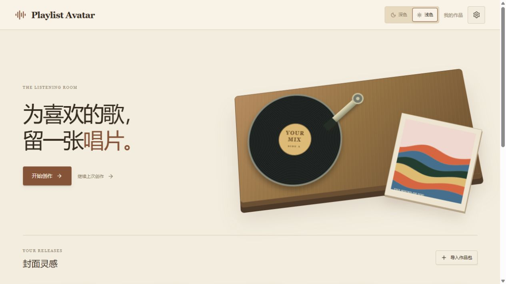
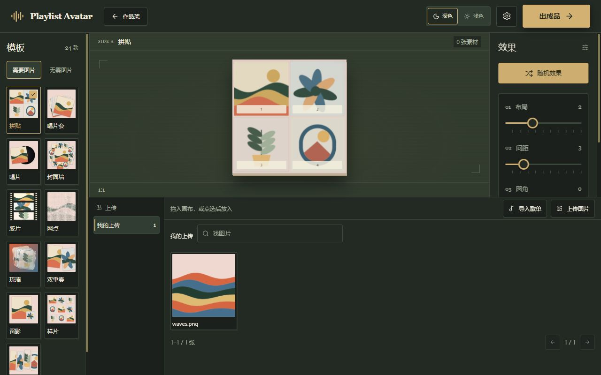

# Playlist Avatar

[English](README.md)

一个属于封面的听音室。用网易云音乐或 QQ 音乐公开歌单、自己的图片，或原创生成风格制作头像与封面。选模板、按需放图、调少量效果，即可保存或导出。普通制作流程无需音乐账号、API Key 或自定义 API 地址。





24 套模板涵盖封面构图、复古印刷、抽象生成和光学材质。支持 PNG、JPG、WebP，以及 512、1024、2048px；可选圆形裁切，PNG/WebP 可保留透明背景。抽象效果使用构图参数与可用的来源统计，不做真实音频分析。


## 在电脑上启动

需要运行中的 Docker Desktop、用于首次构建和公开导入的网络，以及现代浏览器。应用由 Docker 构建，无需另装 Node、数据库或 Redis。

1. 将源码包解压到一个文件夹，保留 `compose.yaml`、`Dockerfile`、`apps`、`packages` 等文件的结构。
2. 在这个文件夹打开终端。Windows 可在资源管理器地址栏输入 `powershell` 后回车；macOS/Linux 在终端进入解压目录。
3. 运行：

   ```sh
   docker compose up -d --build
   ```

4. 等待构建完成，打开 **[http://127.0.0.1:8080](http://127.0.0.1:8080)**。以后使用相同地址访问原来的浏览器作品库。

如果8080端口被占用，将 `.env.example` 复制为 `.env`，同时修改下面两行，再启动：

```dotenv
APP_PORT=18080
PUBLIC_ORIGIN=http://127.0.0.1:18080
```

然后打开 [http://127.0.0.1:18080](http://127.0.0.1:18080)。Windows复制命令为 `Copy-Item .env.example .env`，macOS/Linux为 `cp .env.example .env`。以后若配置了可选Key，不要公开 `.env`。

## 制作第一张封面

1. 在首页点“新建作品”，或选择一张灵感模板。保存作品后，首页逐渐成为你的作品架。
2. 左侧始终可以选模板。“无需图片”模板只需调整效果；“需要图片”模板默认在固定位置显示原创插画。
3. 有图模板在下方点“导入歌单”或“上传图片”。粘贴公开分享内容、读取后点“保留这些封面”。尚未添加任何素材时，整个图片区会在中央展示导入与上传按钮。系统按最近、歌单、上传和作品归集图片；点一次来源即可检索、分页选图。导入不会覆盖当前作品。
4. 将图片拖到画布位置，或先点一张图片再点一个位置。放置后自动取消选择，同图可以放到多个位置；“画布中”标记当前素材。替换后的恢复按钮：编辑已有作品时回到原图，新建时回到默认插画。
5. 在右侧滑动少量效果参数。“随机效果”只随机这些可见参数并记录结果，可用撤销、重做或Ctrl/Cmd+Z找回；“恢复默认”重置风格设置并保留图片位置。字形模板有自己的文字输入，切换模板会保留各模板的创作状态。
6. 点“出成品”。可以命名并收入作品架，或导出512、1024、2048px的PNG/JPG/WebP。支持圆形裁切，PNG/WebP可透明，JPG使用实色背景；下载未发起时可点“保存图片文件”。

模板、效果和图片区域各自滚动，画布与成品入口保持可用。偏好设置提供中英文、深浅主题及减少动态效果；首页唱片缓慢循环转动，封面悬停、按最终裁切飞入和短切换动效构成听音室的氛围，没有音乐播放或音频分析。

## 保存和管理作品

“收入作品架”将配方和真实图片保存在这个浏览器中。点已有作品继续编辑，再保存会更新它；作品菜单可“以此为模板”、改名、前移/后移、备份和删除，也可拖动作品卡片调整顺序。以此为模板会创建新草稿，保留原作品。删除需二次确认并明确提示无法恢复，确认后作品直接移除；图库中的素材仍保留。重要作品请先备份。

浏览器存储可用时会自动保存草稿，“继续上次创作”可恢复当前会话；“最近”来源自动保留之前创作的图片，不必自己管理文件夹或标签。命名作品和ZIP完整保留放置图片、各模板变体及恢复基线，一个工作区最多50张不同图片；未选择的来源图片留在图库，不塞入每件作品或ZIP。

作品库属于**浏览器配置文件和网站origin**，包括协议、主机名和端口。换浏览器、设备、端口、`localhost`/`127.0.0.1`写法或HTTP/HTTPS地址，会看到不同作品库。应用没有安装式离线PWA；重新打开完整页面仍需要服务。已保存作品使用真实图片Blob，无需音乐服务持续可用。

从作品菜单“备份作品包”下载ZIP，在作品架“导入作品包”恢复为新作品。清除网站数据、换地址、换浏览器或更新前先备份；包中没有连接凭据和无关图库图片。旧配方及模板ID保持原效果，明确编辑或重置后才采用对应变化。见[备份、更新和回退](docs/maintenance.md)。

“偏好设置→管理本地数据”提供独立清理范围。“全部作品”在确认后永久移除已存作品；清理图片库保留仍被已存作品引用的图片数据。保存失败或配额不足不会自动删除作品。

## 停止、重启和检查

在同一目录运行：

```sh
docker compose ps
docker compose stop
docker compose start
docker compose logs --tail 30
```

`stop`停止这个应用；关闭网页不会停止容器或Docker Desktop。`docker compose down`移除应用容器及网络，浏览器作品仍在浏览器中。需要保留作品时，请先备份再清除浏览器网站数据。

## 本地镜像与NAS

当前交付候选提供本地构建镜像，**尚未发布公共镜像地址**。可以按前面的命令从源码构建，也可以加载已提供的对应架构镜像包：

```sh
docker load -i playlist-avatar-0.2.1-amd64.tar.gz
docker compose up -d --no-build
```

本轮0.2.1 ARM包已构建，但当前主机无法运行ARM仿真，运行兼容性仍待验证。原生64位ARM设备加载 `playlist-avatar-0.2.1-arm64.tar.gz`，在 `.env` 中设置 `PLAYLIST_AVATAR_IMAGE=playlist-avatar:0.2.1-arm64`，再运行相同的 `up -d --no-build`。这些是本地镜像名称，并非可拉取的注册表地址。见[交付状态与已测架构](docs/release.md)。

默认只允许本机访问。在NAS或其他设备使用时，配置可信的HTTPS反向代理，将 `PUBLIC_ORIGIN` 设为浏览器访问的精确origin，并只向该代理开放容器。浏览器存储与图片哈希需要安全上下文，即HTTPS或本机回环地址；普通 `http://NAS-IP` 不是受支持的远程部署。代理需保留匹配的Host和安全响应头。不要挂载音乐目录或Docker socket到应用。详见[部署选项](docs/deployment.md)。

## 可选高级来源

“更多来源”需要用户主动进入。Last.fm由管理员在服务端配置Key，用户只填用户名和平台原生期间。Navidrome/OpenSubsonic、Jellyfin及兼容网易私人API需要明确配置的允许档案，以及用户本人权限。默认Compose不启动这些服务。

当前候选**尚未验证这些来源的真实实例兼容性**。适配和隔离有固定响应测试，不能当成真实兼容保证。QQ私人会话目前不可用，不会伪装成已实现的登录入口。见[高级配置与目标版本](docs/advanced-sources.md)。

## 隐私、限制与问题处理

编辑、保存和导出在浏览器完成。Node服务接收必要公开链接/ID，读取所选来源并受限转发封面；可选私人凭据会传给自己的Node部署及指定音乐服务。默认无遥测、自动音乐账号或局域网发现。公开元数据有有界的五分钟内存缓存，图片ticket会过期，不是永久图片存储。发行物不含平台封面，请使用有权使用的图片。

默认容器限制256MiB内存、一个逻辑CPU；最多2个活动解析、8个排队、4路封面流。每段最多2000条元数据和50张候选封面，画布最多16个图片位置，工作区各模板与恢复基线共最多50张不同图片，图库最多1000张。本地PNG/JPEG/WebP上限20MiB/24MP，远程图上限8MiB/16MP；规范化导入批次预算32MiB。浏览器作品空间上限500MiB，并受实际剩余额度约束。这些是保护限制，不是空闲实用量。见[实测与未验证范围](docs/release.md)。

| 现象 | 处理方式 |
| --- | --- |
| 端口占用 | 选空闲端口，同时修改APP_PORT与PUBLIC_ORIGIN。 |
| 页面/API提示禁止访问 | 使用配置的精确origin，核对代理Host。 |
| 公开歌单读不到 | 确认公开，稍后重试，换链接或本地图片；不会强推登录作为兜底。 |
| 封面缺失/被跳过 | 选其他已准备候选或本地图片，原作品会保留。 |
| 保存失败 | 先导出备份，检查存储权限/空间，再在作品库明确选择清理内容。 |
| 无法编码JPG/WebP | 改用PNG；不会只改后缀伪装成另一格式。 |
| 记住的高级连接失效 | 重新连接所选档案；服务重启会使临时会话失效。 |

开发说明见[development.md](docs/development.md)。第三方许可证原文包含在源码和镜像中；自有代码暂标记 `UNLICENSED`，公共发行的许可证和目的地等待项目所有者确认。
