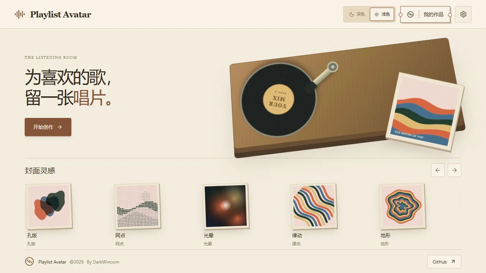
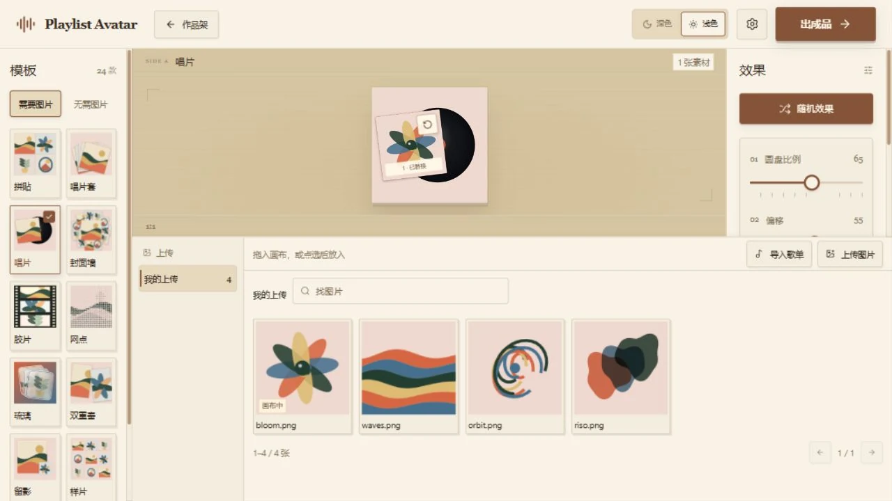
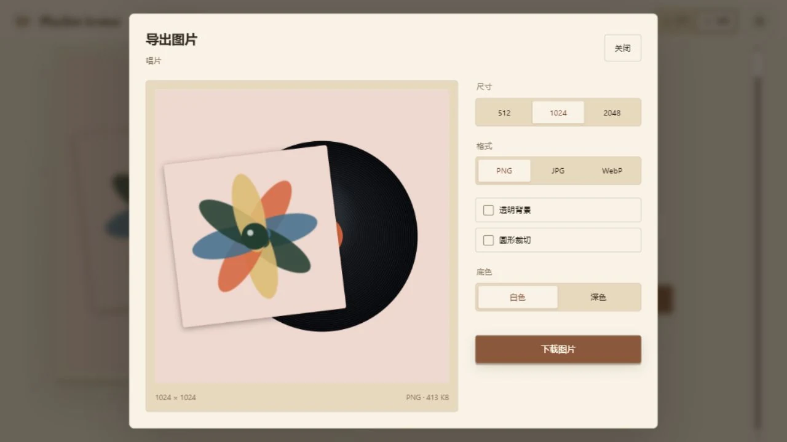

<div align="center">


# Playlist Avatar

**把喜欢的音乐，做成自己的封面。**

[English](README.md) · **简体中文**


网易云 / QQ 音乐歌单、自己的照片，或一张原创图。
选个风格，轻轻调整，做出属于你的头像与封面。

</div>



## 总有一种风格，合你的拍子

24 款风格，从唱片、拼贴、复古印刷到光晕与流动线条。没有图片，也能开始。


| 放进喜欢的图片 | 让灵感动起来 |
| --- | --- |
| 导入公开歌单或上传照片，拖到画布就能换封面。 | 旋转的唱片、轻巧的换纸、跟手的放图。深浅主题都好看。 |
| **少一点选择困难** | **自己的作品架** |
| 几个滑杆、随机效果、撤销与重置，随手试出喜欢的效果。 | 保存、续作、改名、排序；上次的草稿也还在。 |



## 喜欢，就带走

从作品菜单直接导出。先看效果，再下载同一张图片。
PNG / JPG / WebP · 512 / 1024 / 2048px · 圆形裁切 · 透明背景



## 用 Docker 启动

下载并解压 [项目源码](https://github.com/DarkWinoom/playlist-avatar/archive/refs/heads/main.zip)，在该文件夹执行：

```sh
docker compose up -d --build
```

打开 **[http://127.0.0.1:8080](http://127.0.0.1:8080)**，开始创作。

无需音乐账号或 API Key。作品和草稿保存在当前浏览器，继续使用相同地址即可找回。
公开歌单的读取需要联网；使用自己的照片或原创风格也一样好玩。

---

<div align="center">

[反馈问题](https://github.com/DarkWinoom/playlist-avatar/issues) · [第三方许可](THIRD_PARTY_NOTICES.md)

Playlist Avatar © 2026 DarkWinoom

</div>
