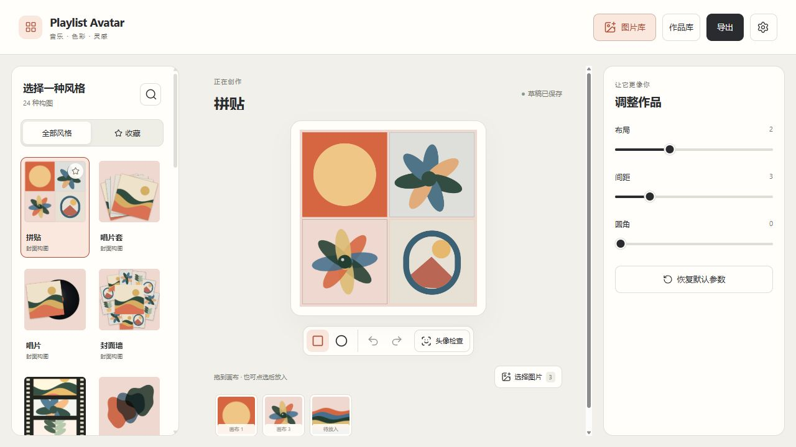

# Playlist Avatar

[English](README.md)

把网易云音乐或 QQ 音乐的公开歌单做成头像、封面。选择风格、调整少量参数、下载作品。有图风格默认使用原创插画；将封面导入图片库后，把想用的图片拖到画布上。普通制作流程无需音乐账号、API Key 或自定义 API 地址。



24 套模板涵盖封面构图、复古印刷、抽象生成和光学材质。支持 PNG、JPG、WebP，以及 512、1024、2048px；可选圆形裁切，PNG/WebP 可保留透明背景。抽象效果使用构图参数与可用的来源统计，不做真实音频分析。


## 在电脑上启动

需要运行中的 Docker Desktop、用于首次构建和公开导入的网络，以及现代浏览器。应用由 Docker 构建，无需另装 Node、数据库或 Redis。

1. 将源码包解压到一个文件夹，保留 `compose.yaml`、`Dockerfile`、`apps`、`packages` 等文件的结构。
2. 在这个文件夹打开终端。Windows 可在资源管理器地址栏输入 `powershell` 后回车；macOS/Linux 在终端进入解压目录。
3. 运行：

   ```sh
   docker compose up -d --build
   ```

4. 等待构建完成，打开 **[http://127.0.0.1:8080](http://127.0.0.1:8080)**。以后使用相同地址访问原来的浏览器作品库。

如果8080端口被占用，将 `.env.example` 复制为 `.env`，同时修改下面两行，再启动：

```dotenv
APP_PORT=18080
PUBLIC_ORIGIN=http://127.0.0.1:18080
```

然后打开 [http://127.0.0.1:18080](http://127.0.0.1:18080)。Windows复制命令为 `Copy-Item .env.example .env`，macOS/Linux为 `cp .env.example .env`。以后若配置了可选Key，不要公开 `.env`。

## 制作第一张图片

1. 选择风格。色彩构图无需图片；有图风格的固定位置会显示原创插画，不上传也能制作。
2. 有图风格点击“图片库”或“选择图片”。“上传图片”加入本地PNG/JPEG/WebP；“导入歌单”打开公开分享弹窗，读取后点“加入图片库”。导入不改变当前风格或作品。
3. 选择这次要用的图片，点击“使用所选图片”。也可以一张都不选，保留默认插画。将下方一排图片拖到画布对应位置；同图可放多处，缩略图会标出当前位置。也可先点图片，再点画布位置。
4. 调整风格参数。提供“构图编号”的风格，同编号、同参数会得到同效果，可随时复用。“恢复默认参数”保留图片和放置位置。点画布中的图片可以裁切；按钮或Ctrl/Cmd+Z可撤销、重做。
5. 点击“导出”，选择尺寸和格式，再点“下载”。未自动保存时使用“保存图片文件”。圆形预览与导出的“圆形裁切”分别设置；JPG使用实色背景。

图片库由同一浏览器地址下的作品共用。移除图片需确认，已经保存在作品中的图片会保留；“管理本地数据”分别提供作品和图片库范围。旧作品重开时保留原效果，切换风格或重置才采用当前默认值。作品包只包含这张作品选择及使用的图片，不打包整个图库。

窄屏使用底部“风格/图片/调整”。偏好设置提供中英文、主题和减少动态效果。编辑器去掉了自由配色、通用标题、图片排序和权重操作；字形风格保留与构图相关的文字参数。

## 保存作品

在“作品库”里“保存当前”或“另存为”，配方和实际图片都保存在这个浏览器中。浏览器存储可用时草稿也会自动保存，请留意预览旁的状态。音乐服务失效后，在已经加载的编辑器中仍可重开已保存作品并导出。

作品库属于**浏览器配置文件和网站origin**，origin包括协议、主机名、端口。换浏览器、设备、端口、`localhost`/`127.0.0.1`写法或HTTP/HTTPS地址，会看到不同作品库。应用没有安装式离线PWA能力；重新打开完整页面仍需要应用服务。

“作品库→备份”下载所选作品的ZIP，包含配方、裁切及选中和备用的规范化素材。“导入作品文件”会恢复成一个新作品。清除网站数据、换地址、换浏览器或更新应用前先备份；作品包不含连接凭据。完整步骤见[备份、更新和回退](docs/maintenance.md)。

删除作品需确认，随后进入应用回收站，可恢复。“管理数据→作品（含已删除）”会在另一次确认后永久清除全部命名作品及回收站，并非只清空回收站。清理数据可选择范围。保存失败或配额不足不会自动删除已保存作品。

## 停止、重启和检查

在同一目录运行：

```sh
docker compose ps
docker compose stop
docker compose start
docker compose logs --tail 30
```

`stop`停止这个应用；关闭网页不会停止容器或Docker Desktop。`docker compose down`移除应用容器及网络，浏览器作品仍在浏览器中。需要保留作品时，请先备份再清除浏览器网站数据。

## 本地镜像与NAS

当前交付候选提供本地构建镜像，**尚未发布公共镜像地址**。可以按前面的命令从源码构建，也可以加载已提供的对应架构镜像包：

```sh
docker load -i playlist-avatar-0.1.2-amd64.tar.gz
docker compose up -d --no-build
```

本轮0.1.2 ARM包已构建，但当前主机无法运行ARM仿真，运行兼容性仍待验证。原生64位ARM设备加载 `playlist-avatar-0.1.2-arm64.tar.gz`，在 `.env` 中设置 `PLAYLIST_AVATAR_IMAGE=playlist-avatar:0.1.2-arm64`，再运行相同的 `up -d --no-build`。这些是本地镜像名称，并非可拉取的注册表地址。见[交付状态与已测架构](docs/release.md)。

默认只允许本机访问。在NAS或其他设备使用时，配置可信的HTTPS反向代理，将 `PUBLIC_ORIGIN` 设为浏览器访问的精确origin，并只向该代理开放容器。浏览器存储与图片哈希需要安全上下文，即HTTPS或本机回环地址；普通 `http://NAS-IP` 不是受支持的远程部署。代理需保留匹配的Host和安全响应头。不要挂载音乐目录或Docker socket到应用。详见[部署选项](docs/deployment.md)。

## 可选高级来源

“更多来源”需要用户主动进入。Last.fm由管理员在服务端配置Key，用户只填用户名和平台原生期间。Navidrome/OpenSubsonic、Jellyfin及兼容网易私人API需要明确配置的允许档案，以及用户本人权限。默认Compose不启动这些服务。

当前候选**尚未验证这些来源的真实实例兼容性**。适配和隔离有固定响应测试，不能当成真实兼容保证。QQ私人会话目前不可用，不会伪装成已实现的登录入口。见[高级配置与目标版本](docs/advanced-sources.md)。

## 隐私、限制与问题处理

编辑、保存和导出在浏览器完成。Node服务接收必要公开链接/ID，读取所选来源并受限转发封面；可选私人凭据会传给自己的Node部署及指定音乐服务。默认无遥测、自动音乐账号或局域网发现。公开元数据有有界的五分钟内存缓存，图片ticket会过期，不是永久图片存储。发行物不含平台封面，请使用有权使用的图片。

默认容器限制256MiB内存、一个逻辑CPU；最多2个活动解析、8个排队、4路封面流。每段最多2000条元数据、50张候选、16张作品用图。本地PNG/JPEG/WebP上限20MiB/24MP，远程图上限8MiB/16MP；规范化导入批次预算32MiB。浏览器作品空间上限500MiB，并受实际剩余额度约束。这些是保护限制，不是空闲实用量。见[实测与未验证范围](docs/release.md)。

| 现象 | 处理方式 |
| --- | --- |
| 端口占用 | 选空闲端口，同时修改APP_PORT与PUBLIC_ORIGIN。 |
| 页面/API提示禁止访问 | 使用配置的精确origin，核对代理Host。 |
| 公开歌单读不到 | 确认公开，稍后重试，换链接或本地图片；不会强推登录作为兜底。 |
| 封面缺失/被跳过 | 选其他已准备候选或本地图片，原作品会保留。 |
| 保存失败 | 先导出备份，检查存储权限/空间，再在作品库明确选择清理内容。 |
| 无法编码JPG/WebP | 改用PNG；不会只改后缀伪装成另一格式。 |
| 记住的高级连接失效 | 重新连接所选档案；服务重启会使临时会话失效。 |

开发说明见[development.md](docs/development.md)。第三方许可证原文包含在源码和镜像中；自有代码暂标记 `UNLICENSED`，公共发行的许可证和目的地等待项目所有者确认。
